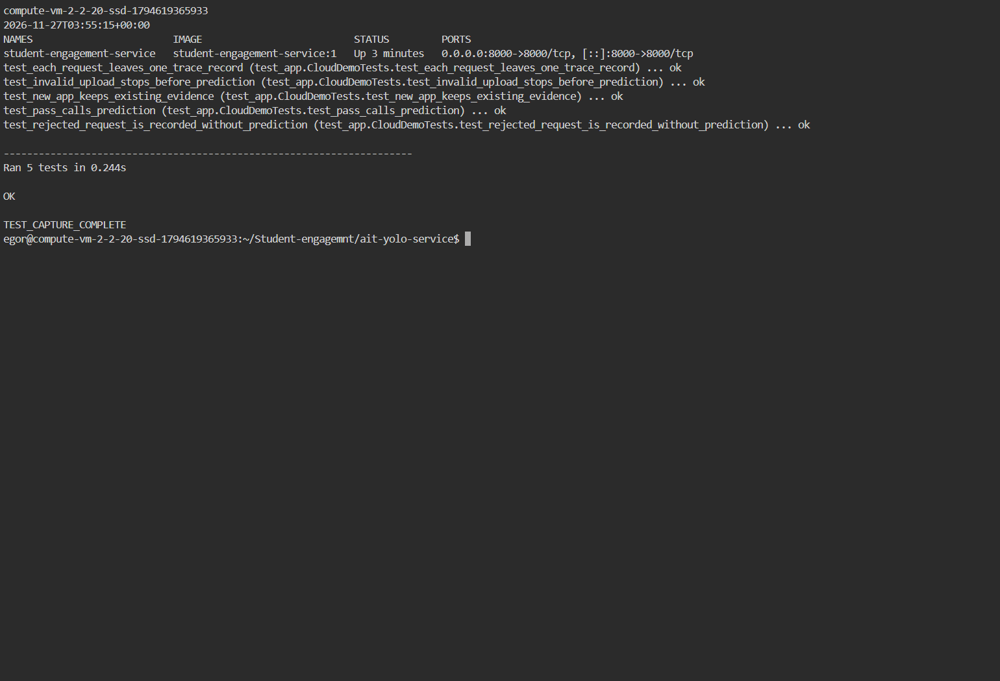
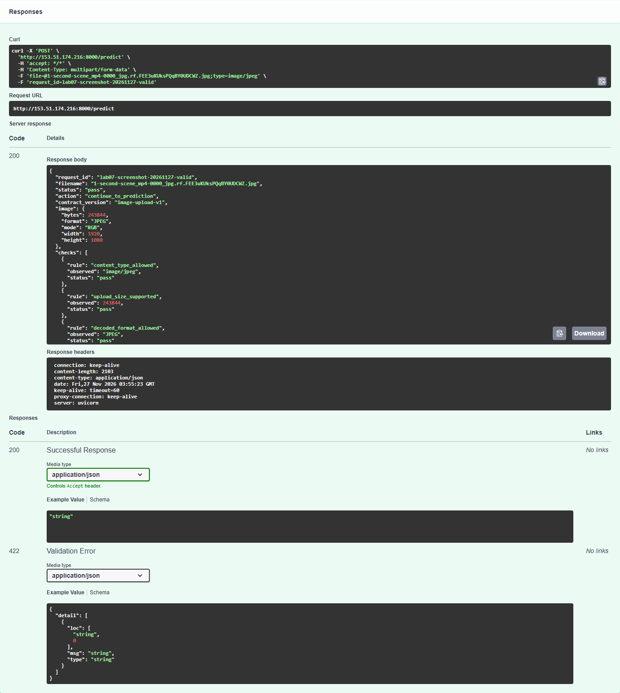
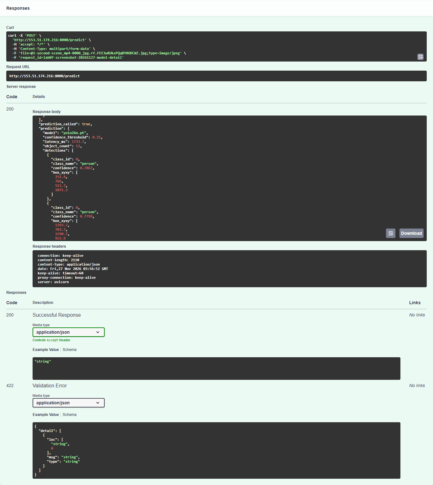
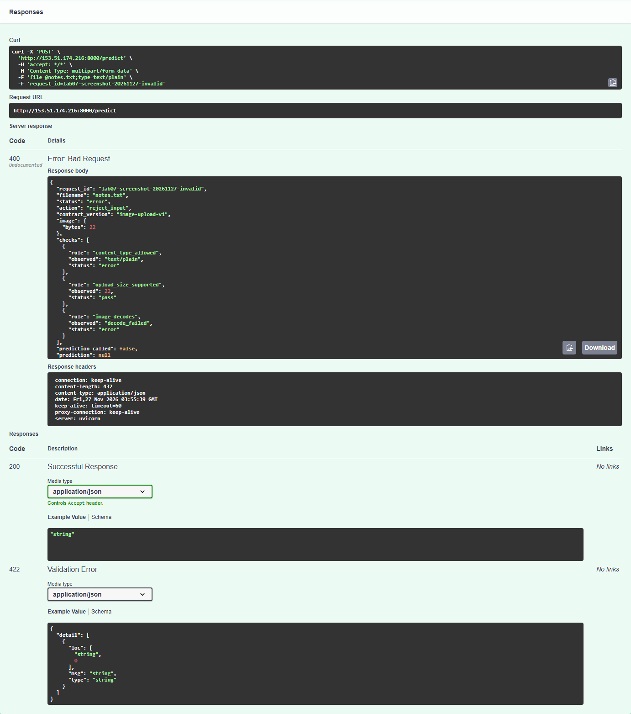
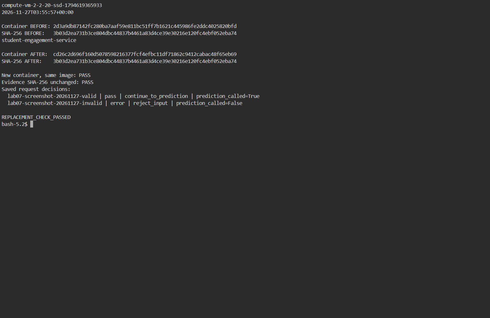
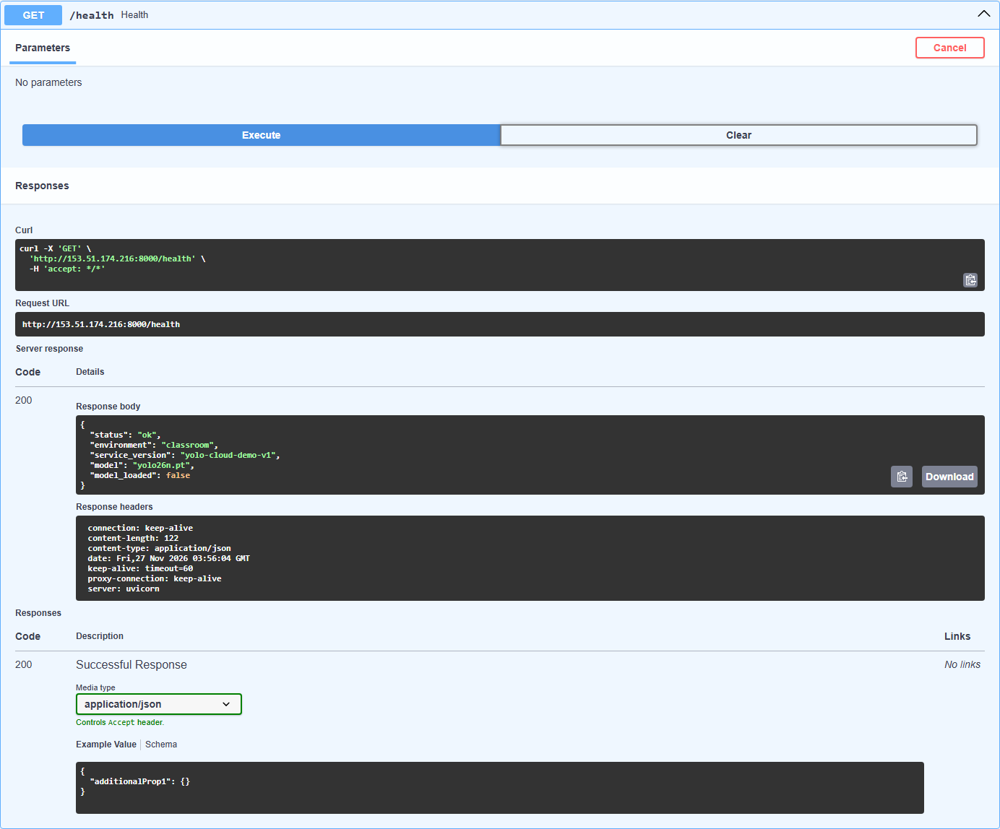

# Lab 07 result screenshots

Captured on 27 November 2026 from the running service on the team's Yandex
Cloud VM, `153.51.174.216`. Swagger requests were sent from the Windows
computer directly to the public API. Terminal screenshots show an actual
shell on the VM, accessed through an SSH tunnel. Terminal and HTTP timestamps
use UTC; the capture date is also 27 November in Asia/Irkutsk.

## Container and tests

The named image is running on port 8000. All five API tests pass inside Docker.

## Valid classroom image

The classroom JPEG returns HTTP 200 and `continue_to_prediction`.

A further valid request shows `prediction_called: true`, the real
`yolo26n.pt` model and its detections. This detail screenshot was taken
after container replacement and the health check shown below.

## Rejected input

A text file returns HTTP 400, `reject_input`, `prediction_called: false`
and `prediction: null`. This is the expected invalid-input result.

## Evidence after container replacement

The container ID changes, the image stays the same, and the journal SHA-256
matches before and after replacement. Both request decisions remain present.

## API after replacement

The new container answers `/health` with HTTP 200 from the Windows computer.
`model_loaded: false` is expected before its first valid request; the model
detail screenshot above shows that subsequent request reaching inference.

The demonstration container was stopped after capture. The image and
request evidence remain on the VM. See the [run instructions](../docs/container_service.md)
to start it again for the defense.
